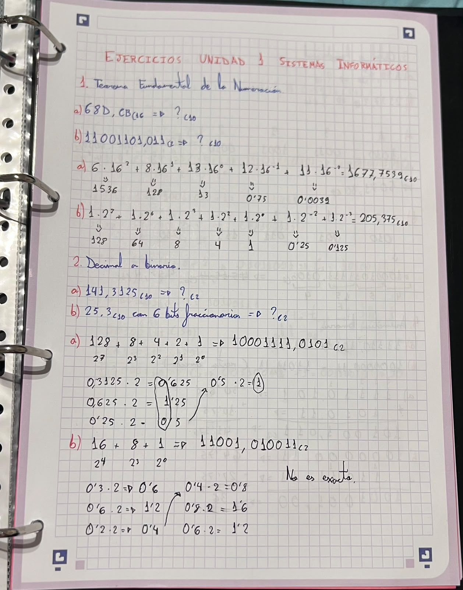
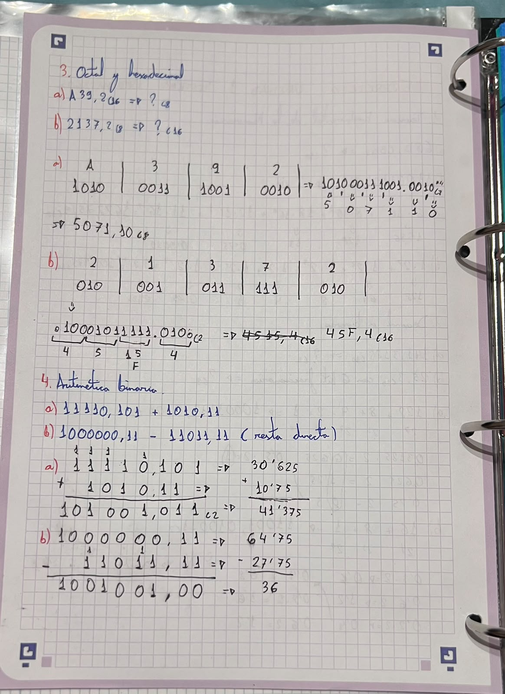
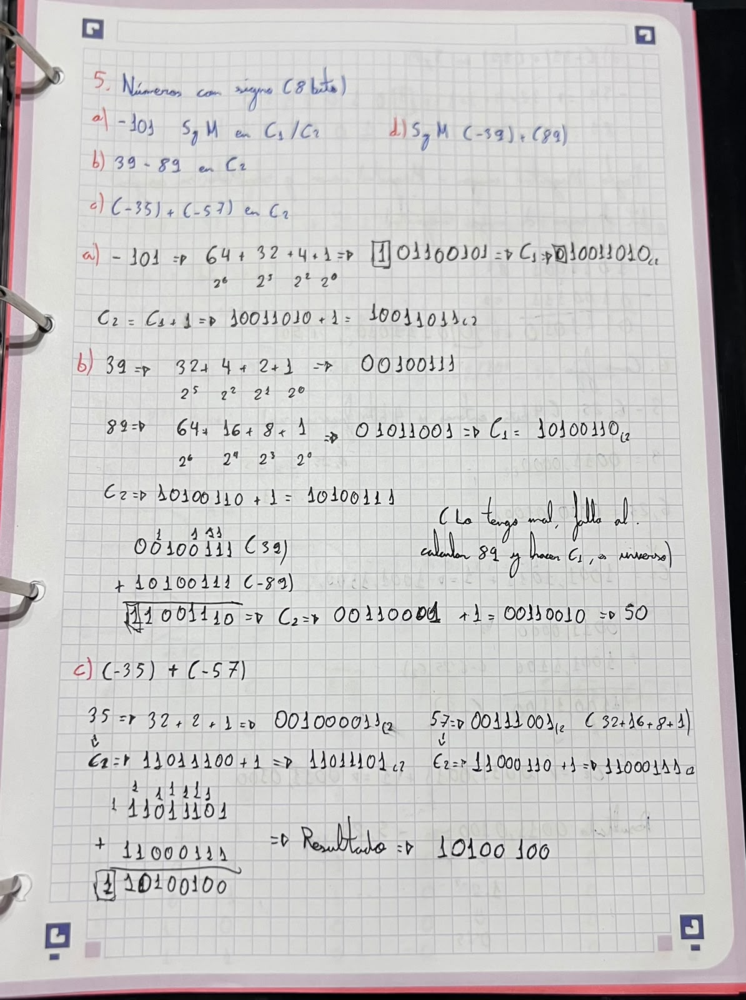
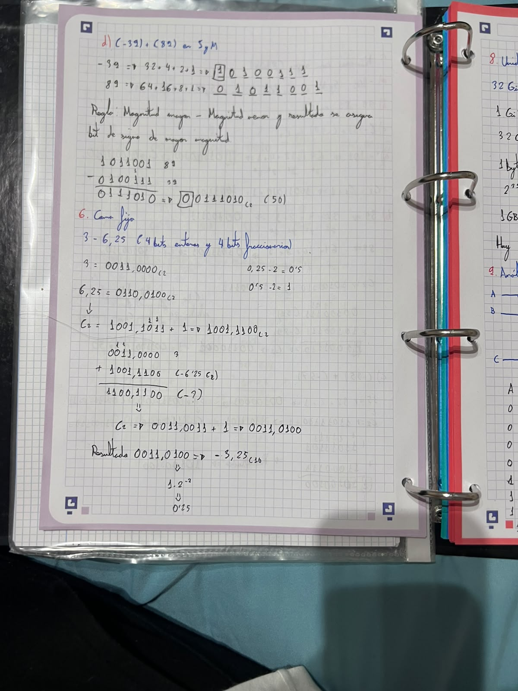
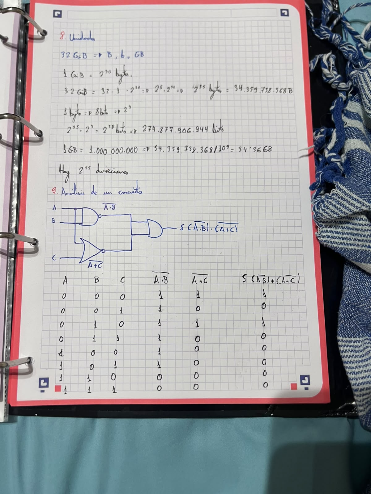

# Relación de Ejercicios de Binario y de Puertas Lógicas

> @autor: Caleb MC

## Relación 15

### Ejercicio 1

- Apartado a 1677.79296875 (10
- Apartado b 205.375 (10

### Ejercicio 2

- Apartado a 10001111.0101 (2
- Apartado b 11001.010011 (2

**La siguiente imagen corresponde a los ejercicios 1 y 2:**

### Ejercicio 3

- Apartado a 101000111001.0010 (2 // 5071.10 (8
- Apartado b 10001011111.0100 (2 // 45F.4 (16

### Ejercicio 4

- Apartado a 101001.011 (2 // 41.375 (10
- Apartado b 100101.00 (2 // 37 (10

**La siguiente imagen corresponde a los ejercicios 3 y 4:**

### Ejercicio 5

- Apartado a 11100101 (S y M // 10011010 (C1 // 10011011 (C2
- Apartado b 11001110 (C2 // -50 (10
- Apartado c 10100100 (C2 // -92 (10
- Apartado d 00110010 (S y M // 50 (10

**La siguiente imagen corresponde al ejercicio 5, apartados a, b y c:**

### Ejercicio 6

- 1100.1100 (C2 // -3.25 (10

**La siguiente imagen corresponde al ejercicio 5 apartado d y al ejercicio 6:**

### Ejercicio 8

- 32 GiB = 2^35 bytes = 34.359.738.368 B
- 32 GiB = 2^38 bits = 274.877.906.944 b
- 32 GiB = 34.36 GB
- Hay 2^35 direcciones

### Ejercicio 9

S = (A·B)' · (A+C)'

| A | B | C | (A·B)' | (A+C)' | S |
|---|---|---|--------|--------|---|
| 0 | 0 | 0 | 1 | 1 | 1 |
| 0 | 0 | 1 | 1 | 0 | 0 |
| 0 | 1 | 0 | 1 | 1 | 1 |
| 0 | 1 | 1 | 1 | 0 | 0 |
| 1 | 0 | 0 | 1 | 0 | 0 |
| 1 | 0 | 1 | 1 | 0 | 0 |
| 1 | 1 | 0 | 0 | 0 | 0 |
| 1 | 1 | 1 | 0 | 0 | 0 |

**La siguiente imagen corresponde a los ejercicios 8 y 9:**

### Fecha: 15-October-2026
